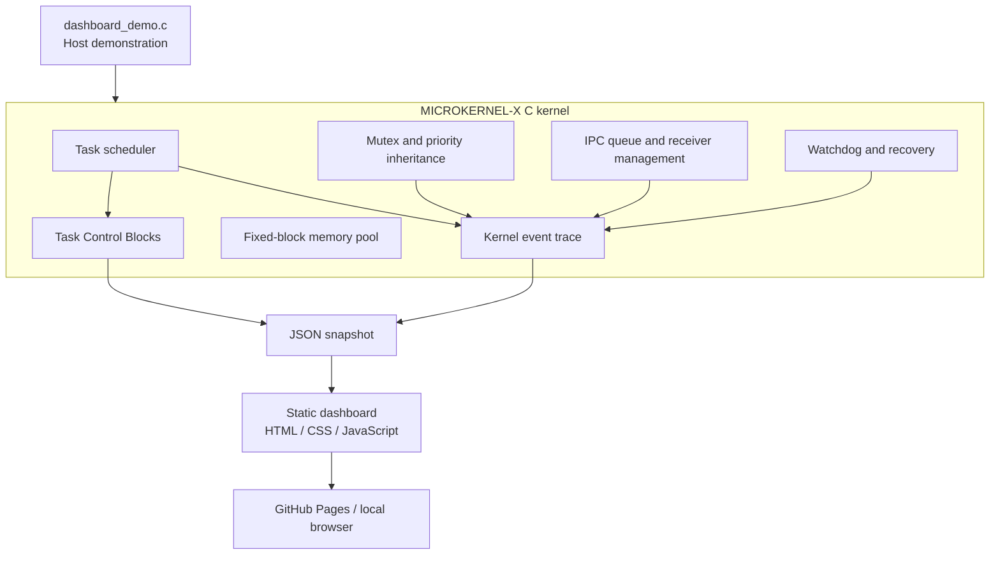

# MICROKERNEL-X

**An experimental C microkernel / RTOS-style project with a Cortex-M4 context-switching port.**

<p align="center">
  <a href="https://balu2004naidu-hue007.github.io/MICROKERNEL-X/"><strong>Open the interactive kernel dashboard ↗</strong></a>
  &nbsp;·&nbsp;
  <a href="#run-the-visual-dashboard">Run the dashboard locally</a>
  &nbsp;·&nbsp;
  <a href="#build-and-test">Build and test</a>
</p>


**Status:** Laptop-validated release candidate. The host regression suite and ARM/QEMU runtime checks passed. Physical Cortex-M hardware validation remains outstanding; this project is not production-ready firmware.

## What you can see

The repository includes an interactive, static dashboard for exploring a deterministic host demonstration of the kernel. It visualizes:

- Task Control Blocks and their READY, RUNNING, BLOCKED, WAITING and FAULTED states.
- Scheduler decisions, context switches and explicit task-progress reports.
- Mutex lock/wait/unlock events and priority inheritance/restoration.
- IPC send/receive and receiver wake-up.
- Watchdog fault detection, task restart, verified recovery and isolation.
- Fixed-block memory-pool availability.

**The dashboard uses real kernel C APIs.** `dashboard_demo.c` exercises the same task, scheduler, mutex, IPC, watchdog/recovery, trace and memory-pool modules, then exports the retained kernel trace and task snapshot as JSON. It is a deterministic host demonstration, not fabricated live hardware telemetry.

### Dashboard preview

Open the [interactive dashboard](https://balu2004naidu-hue007.github.io/MICROKERNEL-X/) after GitHub Pages deployment, or run it locally using the instructions below.

## Core features

### Task management and scheduling
- Task Control Blocks and task lifecycle states.
- Task selection, blocking, unblocking, delays and priority-aware scheduling.
- Time-slice handling, idle-task support, scheduler statistics and preemption support.

### Context validation and fault recovery
- Initial task stack-frame construction and validation.
- Saved stack-pointer bounds and stack-guard validation.
- Runtime stack high-water measurement and stack-usage warnings.
- Watchdog monitoring based on explicit task progress.
- Task context restart, bounded recovery attempts and isolation.
- IPC and mutex resource cleanup before a recovered task becomes READY.

### Synchronization and communication
- Mutex ownership tracking, waiter queues and direct ownership handoff.
- Priority inheritance and priority restoration.
- Recursive-lock and non-owner-unlock rejection, circular-deadlock detection and wait-abort handling.
- Fixed-size IPC message queue, receiver registration, wake-up and timeout tracking.

### Memory management and tracing
- Fixed-block bitmap memory pool supporting up to 32 blocks.
- Allocation, exhaustion, reuse, alignment, invalid-free and double-free checks.
- Optional critical-section callbacks.
- Fixed-size kernel event trace with scheduler, progress, mutex, IPC and recovery event types.

The memory pool needs suitable critical-section callbacks when used concurrently. Without appropriate synchronization callbacks, treat it as single-threaded.

### ARM Cortex-M4 port
- Startup assembly and STM32L476 linker configuration.
- SVC, PendSV and SysTick integration.
- ARM task stack/context initialization and register-preservation tests.
- Stack-guard corruption detection and invalid-context task isolation.
- Scheduler recovery and memory-pool smoke tests under QEMU/GDB.

## Run the visual dashboard

Requirements: GCC and GNU Make.

From the repository root:

```bash
make dashboard-demo
python -m http.server 8000 --directory docs
```

Then open **http://localhost:8000** in a browser. The first command builds and runs `dashboard_demo.c` against the kernel's C modules and refreshes `docs/demo-data.json`; the second serves the dashboard locally. Use a local web server rather than opening `index.html` directly, because the page fetches its JSON snapshot.

To refresh the hosted dashboard, regenerate the data and push the updated source/snapshot to `main`. The GitHub Pages workflow also regenerates the snapshot from the C demo before deployment.

## Architecture



The dashboard is a presentation layer. It does not replace the kernel or simulate a hardware board.

## Build and test

### Host

```bash
make host
make test-host
```

The host regression target runs the main kernel checks and the standalone memory-pool tests.

### ARM firmware and QEMU

Requirements: `arm-none-eabi-gcc`, `arm-none-eabi-objcopy`, `qemu-system-arm` and `gdb-multiarch`.

```bash
make arm-demo
make test-arm-qemu
```

### Full local validation

```bash
make -B test-host
make -B test-arm-qemu
make dashboard-test
```

`-B` forces target rebuilds. The test scripts write generated artifacts under `build/`.

## Validated results

In the November 9 baseline local validation run (before the dashboard trace additions):

- Host runtime exited with code 0.
- Memory-pool tests passed, including allocation, exhaustion, reuse, invalid frees, double frees, alignment and critical-section callbacks.
- ARM memory-pool smoke test: 13 checks, 0 failures.
- ARM stack high-water tests: 2 checks, 0 failures.
- ARM stack-warning tests: 3 checks, 0 failures.
- ARM context-restart tests: 2 checks, 0 failures.
- ARM scheduler-recovery tests: 4 checks, 0 failures.
- Register-preservation test: 1,000 checks, 0 failures.
- ARM QEMU runtime: 2,002 context switches, with no reported failures.
- SysTick reschedule requests: 2,002; normal ticks: 2,002.
- Time-slice progress/expiry checks: 2,002 each, with 0 timing failures.
- Stack-guard corruption and saved-PC/xPSR corruption were detected.
- An invalid saved stack pointer caused task isolation; the valid task remained selected.
- `git diff --check` completed without whitespace errors after the README line-ending cleanup.

After the dashboard instrumentation was added, the host regression suite and dashboard-specific checks passed again locally. The GitHub Actions CI workflow is configured to rerun the host and ARM/QEMU tests on repository updates. These results do not prove physical-board operation, all interrupt sequences, or all possible concurrency/fault conditions. The earlier Windows GDB build emitted non-fatal OS ABI warnings during the QEMU run.

## Continuous integration and Pages

- `.github/workflows/ci.yml` runs host and ARM/QEMU regression checks on pushes and pull requests.
- `.github/workflows/pages.yml` builds the host dashboard snapshot and deploys the `docs/` site to GitHub Pages on pushes to `main` and manual runs.
- The first remote GitHub Actions and Pages runs must complete successfully before describing those hosted workflows as verified.

## Known limitations

- Physical STM32L476/Cortex-M hardware validation has not been performed.
- The ARM SysTick interval uses the demo's stated 4 MHz reset-clock assumption; actual board clock configuration and timing need hardware verification.
- Broader stress testing, longer-duration testing and more fault-injection combinations remain future work.
- The host critical-section backend assumes a single-threaded runtime; it is not a host-thread synchronization primitive.
- The dashboard displays a generated deterministic host snapshot, not continuous device telemetry.

## Build requirements

- Host: GCC and GNU Make.
- ARM/QEMU: `arm-none-eabi-gcc`, `arm-none-eabi-objcopy`, QEMU ARM system emulation and `gdb-multiarch`.
- Dashboard: any modern browser; Python 3 is used only for the local static HTTP server (or any equivalent static web server).

## License

MIT. See [LICENSE](LICENSE).

## Author

Balaji Naidu
